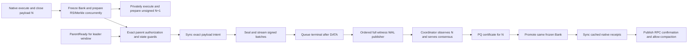

# Native PQ production pipeline

The experimental Agave validator executes transactions in its native Bank/SVM and AccountsDB. Quantumglow and the durable Ax signer remain on one coordinator. Bounded workers perform production, received-candidate reconstruction/execution, ordered body persistence, witness publication and ordered native promotion/archive.

Main30 retains the private frozen-parent and same-leader computation overlap introduced through Main24, and additionally removes redundant input/wire copies, offloads one exact journal append behind an ACK barrier, indexes finalized membership, avoids unused prepared-candidate snapshots, and moves bounded incoming shred/evidence authentication to the existing workers. One thread-local public-signature canonical parser entry avoids exact repeated parse work. Consensus/admission/action effects remain ordered; these changes introduce neither another SVM loop nor a full account-state copy. The [implementation and remaining limits](native-overlap-main24-to30.md) distinguish each release and its durability gates. The [R30 matched, pressure and sustained points](../results/optimized-native-agave/profiling/pilot-r-main30-accepted-hour/README.md) and the [same-Main30 ordinary reference](../results/optimized-native-agave/profiling/ordinary-main30-vs-pq-r30/README.md) passed their complete acceptance workflows; their configured targets, durations and evidence scopes differ.

N+1 can start before N's complete witness publication, network delivery, certificate and archive finish. The run loop dispatches that ready child immediately after polling worker results, before processing the collected receive batch. Already reconstructed children waiting for a parent are dispatched on result turns as soon as that parent is installed; the 300-ms timer now paces network repair and retransmission. It needs the exact frozen parent identity and state. Certification adopts the executed Bank; it does not run the transactions again. Independent RS/Merkle preparation overlaps native freeze. Immutable ingress entries share transaction data; child account views share the parent's snapshot and retain writes as deltas.

Release19 also prepares one full candidate for the next leader window before `ParentReady`, once that window's predicted parent has been natively validated and frozen. The preparation worker has no signer, Blockstore, consensus machine or stream sender. It executes, closes the payload, freezes the isolated Bank, prepares RS/Merkle batches and binds its native execution capability. Signing starts only after exact parent authorization, current certified ancestry and immutable used-slot/recovery guards pass. Sealing rechecks the parent Arc, leader/slot/profile, payload and complete parent/child state before writing the synced intent. A different authorized parent discards the prediction without pruning admitted identities or burning signing state; a recovered fixed payload takes precedence. Busy and held unsigned results each participate in the shared native Bank capacity bound.

Release19's predictor examined the window immediately following the certified frontier. The current predictor also considers exact private window-tail parents. It still requires matching state, ancestry and capacity; prediction does not authorize signing. Sparse work continues to coalesce. `preparation_us` and `sealing_us` measure separate active worker intervals; `prepared_wait_us` includes authorization and dispatch delay. Their sum is not a continuous interval after authorization. Release19 has 78 native Core cases plus the actual existing rich-K genesis case passing, strict lint/formatting and an optimized build. The fresh-L matched short trial passes at 12,622.94 TPS (1,573,967 successful transactions, zero errors/pending and complete native/custody/fee/background/resource gates), 69.25% above the matched release17 trial. The 3,660-second traffic interval subsequently completed at 9,730.84 TPS with 35,666,259 successes, zero errors/pending and full native/protected-account/fee/background checks. Its final operational workflow is rejected because a log-permission harness bug prevented the final ledger/profile/epoch captures before cleanup. The original rejection remains preserved. Independent qualified source/state verification and complete stopped-log timing/resource analysis now pass; the [ordinary-path comparison](../results/optimized-native-agave/profiling/ordinary-main19-cli7-vs-pq-l19-qualified/README.md) now passes at 15,992.94 TPS over 600 seconds with all 9.6 million source signatures checked on all eight replicas. During near-full same-leader production, 99.86% of eligible children start before prior publication and the median ready-to-next-start gap is 24.61 ms. Near-full leader boundaries still have a 1.373-second median ready spacing. See the [qualified hour report](../results/optimized-native-agave/profiling/hour-l-main19-qualified/README.md).

Version-one candidate identity commits the complete transaction payload. Selection and native execution therefore finish before the first signed batch escapes. A synced immutable payload intent precedes streaming; recovery resumes those exact bytes and their parent. A protocol that streams transactions before selection closes would require a separately specified candidate-identity and recovery format.

Release21 guards wire size before exact-wire deduplication and buffers durable Ax authority encoding in 64 KiB writes, preserving the explicit flush, file sync, rename and directory sync. Its 79 native Core and 15 Ax cases pass. The fresh-M 607-transaction migration/recovery prelude and both fully audited short trials pass, with exact final custody, fees, background state and cleanup. The matched trial measures 10,899.75 TPS and the larger-queue pressure trial 10,745.73 TPS, respectively 13.65% and 4.59% below the corresponding release19 trials. These changes do not establish a throughput gain or isolate either change causally. The closed-payload wire format, coordinator work and leader handoffs remain costs. Latest matched producer work averages 279.94 ms, the median same-leader next-start gap is 21.23 ms and the median near-full boundary ready spacing is 1,079.37 ms. Thirteen nonempty proposals containing 97,075 transaction instances never become finalized slots in the complete stopped logs; all source transactions nevertheless finalize. The log stages do not prove why those proposals were unused. See the [actual short-run resources and timings](../results/optimized-native-agave/profiling/pilot-m-main21-vs-l-main19/README.md) and [release21 validation](../results/optimized-native-agave/validation-release21/early-dedup-and-buffered-signer-store/README.md).

`ParentReady` has no added 500-ms production delay. Sparse or empty work can coalesce for the configured idle interval to preserve a finite Ax allocation. Full ready work bypasses coalescing. At leader boundaries, consensus authorization and availability of the exact native parent remain causal requirements. Repeated parent authorization must preserve an active producer reservation and the durable used-slot fence; the release10 retest exposed a race in that guard, recorded in the [rejected trial](../results/optimized-native-agave/profiling/pilot-f-retuned-rejected/README.md).

Main26 and later submit that append to one bounded journal worker. The caller still waits for the exact durable ACK before releasing the pending transition. During that wait, only previously authorized producer/publication streams are serviced and existing worker jobs may finish; no new receive/admission, QG action, signing authorization, native dispatch or promotion is released from the pending transition. Core encoding and authoritative order remain serial. Main28 separates the journal namespace lock from independent body/intent insertion and preserves synced roots/checksums. See [the exact journal contract](native-journal.md#journal-ack-overlap-in-main26-and-later).

Consecutive received consensus messages can share one synced journal append. Their IDs and actions remain private until that append succeeds, including every finalized reference. A change to another frame class flushes the group before that frame is applied. Standalone evidence remains immediately durable; a typed internal or storage failure stops the batch before completion or signing. This grouping preserves the journal wire and arrival order.

Control and bulk use independent authenticated PQ QUIC connections with ordered streams. Both share bounded per-peer byte/record reservations. A terminal marker is enqueued after its bulk cursor completes; control traffic can pass earlier bulk at the transport. The receiver still requires full authenticated reconstruction and native execution before a candidate can certify. Queue admission is never a certificate.

Release17 gives a ready terminal marker priority over missing-parent requests and routine evidence, and missing-parent requests priority over routine evidence. A full control queue no longer prevents independently budgeted bulk repair. The receiver takes ready bulk after at most eight consecutive control frames, preserving FIFO within each class and the existing exact queue reservations. Regression tests reproduce the former starvation and exercise the new bound over real Falcon/ML-KEM QUIC. These changes improve scheduling; they do not change authenticated bytes, authorize an unavailable parent, or change consensus durability.

Release19 authenticates bounded transaction-gossip batches in the existing worker pool against an exact immutable native root. Workers decode and verify Falcon/AUTH without mutating admission or consensus. The coordinator applies results in original frame order, after the required evidence WAL boundary; a root change reruns both positive and negative authorization through the ordinary ingress path. Exact-wire mempool duplicates retain the cheap dedup path. The 256-frame and 16-KiB transaction limits bound prepared input to 4 MiB.

Unknown recent blockhashes retain their exact acknowledged wires. A bounded, proposal-local parent hash memo filters them before the selection window and full-ready calculation, so they cannot occupy the window ahead of executable traffic. Native durable-nonce first-instruction layouts continue to reach native lifetime/AUTH checks; this does not add post-cutoff AUTH/AdvanceNonce compatibility. Native execution remains authoritative, and `BlockhashNotFound` cannot retire a pending identity. An obsolete producer result cannot prune its rejected IDs. Expiration and durable acknowledgement still require a separate client contract.

The producer stream channel holds one bounded maximum proposal: 64 batch events
and one terminal event, with at most 4,097 frames. Four live candidate streams
and publications, plus the existing native Bank, mempool, repair and peer
transport limits, bound downstream work. Stream ownership follows the existing
producer reservation or exact pending publication; delayed messages from a
retired producer cannot recreate its stream. Capacity waits preserve partial
send cursors and signing state. This fixes the stream-limit failure in the
[rejected release22 sustained attempt](../results/optimized-native-agave/profiling/hour-n-main22-rejected/README.md).
Compaction waits for ordered archive completion, including the interval after
native promotion but before receipt WAL completion.

Release14 preserves local RPC work when the native mempool reaches its count or byte limit. The coordinator holds the exact dequeued transaction and retries it before taking another channel item, while continuing consensus and archive service. The 4,096-item RPC channel supplies backpressure upstream. Stable admission sequences and reverse indexes remove committed aliases and rejected wires from FIFO/gossip indexes without scanning the whole pending set. Queue depth, held-front and capacity/retry counters are exposed separately from mempool depth; an empty mempool alone does not establish drained admission. [Local admission validation](../results/optimized-native-agave/validation-release14/native-admission/README.md) passes; the new saturation and continuous cluster runs require independent acceptance.

Release15 directs canonical root flush, clean, shrink, startup and native dropped-bank maintenance to the original persistent AccountsDB. Certified deltas were already stored there; maintaining the private overlay allowed those original cached roots to accumulate. Private candidate scans and drop callbacks still use their own databases. Native maintenance intervals and the snapshot clean barrier are preserved. A real native regression compares complete state, assets and replay visibility while retaining an executed descendant and a same-slot sibling. With forced maintenance after each of 16 promoted roots, original cached payloads fall from 3,474,576 bytes to 217,161 bytes. This is a local reproduction, not an attribution of all cluster RSS. Status now exposes independently sampled `persisted_accounts_cache` slot, unflushed-root and payload-byte counters; actual maintenance uses the normal 60-second clean interval.

Generator6 shares a 131,072-identity bound between source admission and status routing. Its `soak-validate` command checks actual request budgets, unused outputs, native genesis, active payer policies, credential/address/nonce bindings and SBF/SPL fixtures offline before deployment. Loading credentials uses the existing internal consistency challenge; preflight constructs no transaction and makes no network call or state change. The original transaction retry deadline and exact signed-request handling remain unchanged. Cluster saturation and continuous acceptance must still be established separately from these local checks.

Generator7 selects finalized blockhashes across all configured RPCs using a bounded pool of at most eight workers and a shared two-second deadline. It ranks last-valid block height before context slot, retains the newest selected result, and stops new signing after five seconds without a matching or newer usable refresh. Lower-height replies cannot renew that deadline. Already acknowledged identities remain pending until their exact native receipts arrive or finite drain fails; a null status or advertised expiry height does not permit replacement. The rejected release16 hour exposed the danger of selecting a hash from a lagging node while its acknowledged transactions remained unresolved. Release17's cluster retest must independently establish continuous traffic and complete drain.

Release16 memoizes exact signer-to-policy PDA derivations within each native execution, with at most 4,096 entries. Every signer still contributes its policy account to dependency discovery, including a declared policy write; authorization continues to read the current Bank. The memo contains addresses only and is discarded between executions. It avoids repeated curve-address derivation without caching policy contents or signature acceptance. Migration's final full-custody audits also use a dedicated pool of at most eight readonly workers, preserving manifest order, every-node failures and cross-node equality. [Native validation](../results/optimized-native-agave/validation-release16/native-policy-address-and-migration-audit/README.md) includes 62 Core tests, the actual fresh J genesis, 31 tool tests, strict lint and the optimized build. These checks precede the new cluster performance experiment.

[Accepted release13 short-pilot comparison](../results/optimized-native-agave/profiling/g-short-pilot-comparison.md) shows 94/98 same-leader pairs starting the next producer before prior publication, with a 23.65-ms median ready-to-start gap at 32,768 pending/source. At a handoff, consensus authorization can arrive before native reconstruction; dispatch waits for the maximum of the two readiness times. The measured producer dispatch averages about 21 ms after both prerequisites, while body delivery and native parent availability account for most of the remaining boundary delay. The larger pending window increases observed latency and resource use without raising accepted TPS. [Release12 timings](../results/optimized-native-agave/profiling/pilot-f-fixed/README.md) remain historical evidence. [Phase definitions](native-profiling.md) explain nested timers; [validation](../results/optimized-native-agave/validation-release12/native-pipeline/README.md) distinguishes local tests from cluster acceptance. Finite-epoch rollover, old-intent reclamation and comprehensive hostile candidate-pressure liveness remain design work.
