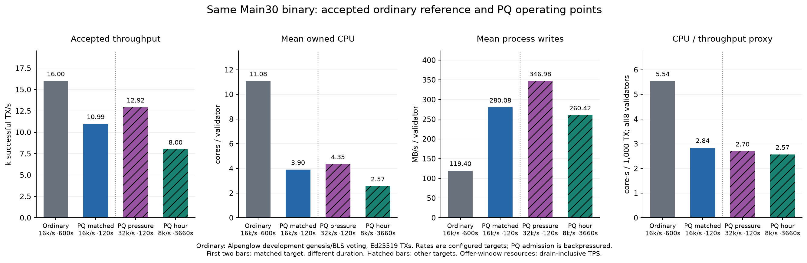

# Accepted Main30 ordinary reference and R30 PQ operating points

The accepted ordinary reference finalized 9,600,000 load transactions at 15,995.04 drain-inclusive TPS. Its worker and supervisor accepted all 14 workflow phases, all-eight full state/signature/status audits and cleanup; all 10 originals were healthy. The same frozen Main30 validator binary runs both paths. The ordinary reference uses this branch’s native Alpenglow development genesis with BLS voting and Ed25519 load transactions, PQ configuration off and native default cost caps; PQ uses experimental Quantumglow/Ax consensus and a PQ AUTH instruction. This is not a production mainnet/Tower400ms baseline.

| Accepted cohort | Configured target, total | Offer duration | Successful load TX | Start through completion | TPS incl. drain |
|---|---:|---:|---:|---:|---:|
| Ordinary | 16,000/s | 600s | 9,600,000 | 600.186s | 15,995.04 |
| PQ matched | 16,000/s | 120s | 1,524,533 | 138.771s | 10,985.96 |
| PQ pressure | 32,000/s | 120s | 1,737,733 | 134.511s | 12,918.89 |
| PQ hour | 8,000/s | 3,660s | 29,275,165 | 3,660.986s | 7,996.52 |

All configured-rate labels denote targets. PQ admission is bounded and backpressured: actual admitted transactions divided by requested offer seconds are Ordinary 16,000.000/s, PQ matched 12,704.442/s, PQ pressure 14,481.108/s, PQ hour 7,998.679/s. This is separate from drain-inclusive TPS; the 32k pressure target was not fully injected. See [observed-admission-rates.json](observed-admission-rates.json).

The matched PQ short achieves 68.68% of the ordinary reference TPS. This is a 16k/s offer match across 120s versus 600s. It is not a matched-duration capacity ceiling, untouched stock release comparison, or isolated cryptographic overhead. The 32k/s pressure trial and 8k/s hour remain different operating points. Keys/genesis, histories, source implementations, wire formats, consensus and configured batch/execution limits differ.

| Cohort | CPU / validator | RSS / validator | Process writes sum | Validator-host RX / TX sum | Generator CPU / RSS sums | CPU/throughput proxy |
|---|---:|---:|---:|---:|---:|---:|
| Ordinary | 11.082 cores | 3.285GiB | 955.238MB/s | 169.844 / 164.076MB/s | 9.600 cores / 0.084GiB | 5.542 core-s /1,000TX |
| PQ matched | 3.900 cores | 3.158GiB | 2,240.640MB/s | 544.021 / 528.652MB/s | 3.502 cores / 0.167GiB | 2.840 core-s /1,000TX |
| PQ pressure | 4.354 cores | 4.074GiB | 2,775.820MB/s | 549.135 / 531.067MB/s | 4.275 cores / 0.231GiB | 2.696 core-s /1,000TX |
| PQ hour | 2.565 cores | 3.906GiB | 2,083.340MB/s | 207.853 / 195.761MB/s | 2.340 cores / 0.178GiB | 2.566 core-s /1,000TX |

For matched PQ divided by ordinary, validator owned CPU rate is 0.352× and physical process-write rate 2.346×; the CPU/throughput proxy ratio is 0.512×. Resource means use each common offer interval; throughput includes source drain. These ratios are proxies, not integrated per-transaction cost or isolated bottleneck measurements. Physical process IO, logical serialized payloads and original-inclusive host network/disk are distinct. Summed node peaks need not coincide; mean CPU and link capacity do not establish saturation.

Both transfer workloads use 256 System and 256 SPL active payers/recipients, amount 1, a 20k CU request limit, 17-byte SBF uniqueness instruction, default native cost caps, 32,768 outstanding/source for the matched comparison, 64 signing threads, 32 HTTP connections and 16-TX batches. Requested CU is not measured consumed CU. Background state includes 10,000 records of 2KiB. Ordinary votes consume resources and are excluded from load TPS. Pressure has 131,072 outstanding/source.

Ordinary audits cover all 12,424 state records per node, complete source receipt bytes and complete finalized load-signature/status vectors on all 8 validators, including fee/state/background oracles. PQ R30 has every-ID finalized observations/digests at the sources, all 8 native slot/count histories and full state/fees/balances, without complete per-load-ID status vectors on every validator; its 607-transaction prelude does have full64-signature archives on all 8. Both actual accepted scopes remain explicit.

| Ordinary source | Successful receipts | Recorded transaction wire bytes | Mean bytes/TX | Complete size histogram |
|---|---:|---:|---:|---|
| System | 4,800,000 | 1,473,600,000 | 307.000 | 307B × 4,800,000 |
| SPL | 4,800,000 | 1,780,800,000 | 371.000 | 371B × 4,800,000 |

The ordinary wire total is 3,254,400,000 bytes, summed from recorded wire_bytes in every complete accepted receipt. PQ raw transaction wire bytes remain unmeasured/null in this report; historical illustrative constants are not substituted. PQ serialized block payload and actual host network rates are separate measurements.

PQ source-observed latency starts after signing and before source job enqueue, and ends when the source processes exact-ID finalized status; it includes queueing, transport, admission, consensus and polling. It is not strictly admission-to-finality. This report does not infer standalone Falcon math, STARK verifier CPU, execution counts or wire-only overhead from aggregate rates. The duplicate-execution status field is literal 0. Existing positive Falcon math-cache behavior is separate from Main30’s new canonical parse shortcut.

The original ordinary attempt failed before source traffic on a missing local readiness dependency. It remains rejected and preserved; this reference uses the separately accepted fresh attempt2. Earlier Q27 continuous failure remains a separate rejected cohort.

The [R30 accepted-hour report](../pilot-r-main30-accepted-hour/README.md) retains all-eight timings, exact-parent handoffs, the actual 840.209ms pressure example, source latency and warm on-chain Verify measurements. Raw stacks, transaction bytes, identities, IPs and private paths are excluded from this numeric projection. [comparison.json](comparison.json) preserves numeric per-node resources, source lanes, wire metadata and hash-only provenance.
