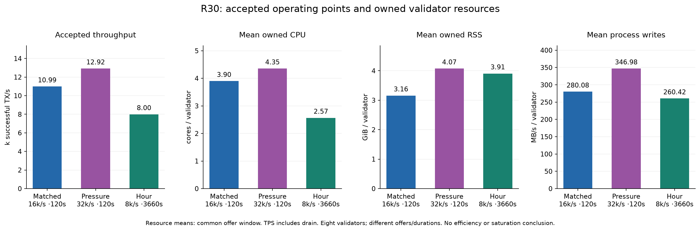
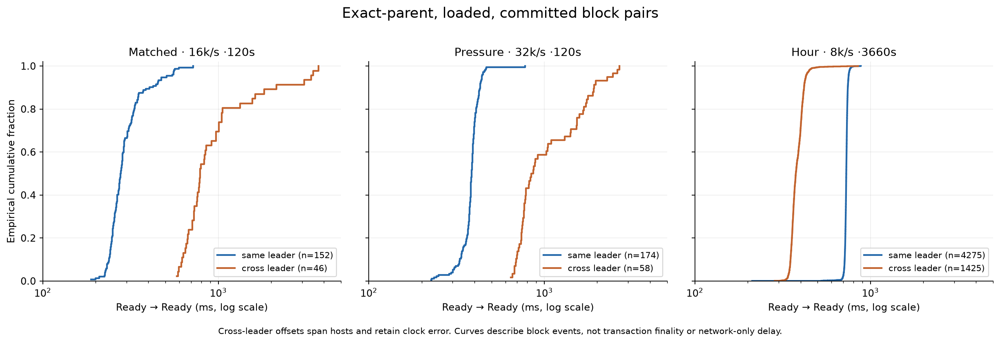
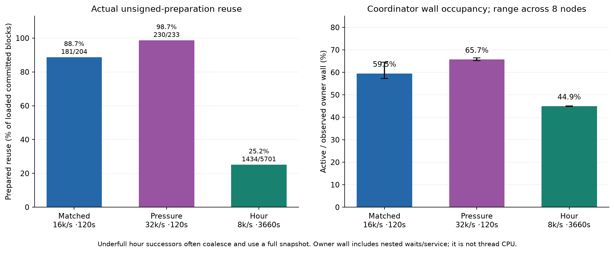
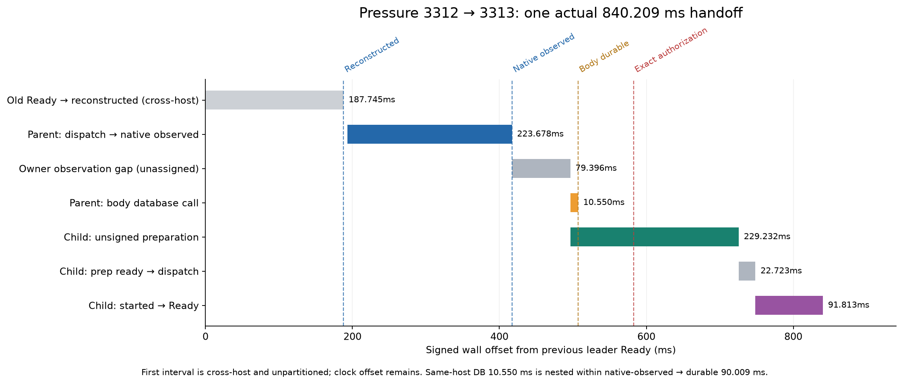

# R30 accepted short trials and continuous hour

All three R30 points passed their full native/state/fee/background acceptance gates. The 61-minute offered run finalized 29,275,165 source transactions at 7,996.52 drain-inclusive TPS, with zero admission/execution errors and zero pending IDs. All eight validators ended at 32,538,038 native transactions, including the 607-transaction prelude and both short trials. Independent cleanup confirmed all owned processes stopped and all ten original validators healthy. All eight stopped logs were captured in eight calls with no retries (1,849,083,077 bytes).

This report covers a fixed committee and a fresh 18,000-slot Ax epoch. The separate [accepted ordinary same-binary reference](../ordinary-main30-vs-pq-r30/README.md) finalized 9,600,000 transactions at 15,995.04 TPS over its 600-second 16k/s offer. Its offer matches the matched short; duration and source/consensus histories differ. It uses this branch’s native Alpenglow development genesis/BLS voting, Ed25519 load transactions, PQ configuration off and native default cost caps, not a mainnet/Tower400ms baseline.

| Accepted point | Configured target, total | Offer duration | Successes | Start through completion | TPS incl. drain | Mean source-observed latency |
|---|---:|---:|---:|---:|---:|---:|
| Matched | 16,000/s | 120 s | 1,524,533 | 138.771 s | 10,985.96 | 4,197.41 ms |
| Pressure | 32,000/s | 120 s | 1,737,733 | 134.511 s | 12,918.89 | 18,299.38 ms |
| Hour | 8,000/s | 3,660 s | 29,275,165 | 3,660.986 s | 7,996.52 | 1,032.16 ms |

All rate labels in the four R30 plots denote configured targets. PQ sources are bounded and backpressured; actual admitted/requested-offer-second rates are matched 12,704.442/s, pressure 14,481.108/s and hour 7,998.679/s. These differ from drain-inclusive TPS; the 32k pressure target was not fully injected. The ordinary reference admitted 9.6M/600s=16,000/s.

Latency starts immediately after signing and before enqueue to the source job; it ends when the source processes the exact ID as finalized. It includes source queueing, transport, admission, consensus and status polling. Source 0 sends System transfers; source 1 sends SPL transfers. Pressure uses 131,072 outstanding/source, versus 32,768 for matched/hour. The matched and pressure offers last 120 seconds; the hour is a predeclared lower 8 k/s operating point.

The load evidence covers every-ID finalized observations/digests at the sources, exact all-eight slot/count histories, all-eight recipient balances, full 2,438 protected-record/810 policy-shaped state and fee/background oracles. It does not contain complete status vectors for every load ID on every validator. The 607-transaction migration/recovery prelude has complete full64-signature archives on all eight: 587 successes and 20 deliberate charged failures.

| Point | Validator CPU sum | CPU / validator | RSS sum | RSS / validator | Process writes sum | Generators CPU sum | Generators RSS sum |
|---|---:|---:|---:|---:|---:|---:|---:|
| Matched | 31.200 cores | 3.900 | 25.264 GiB | 3.158 GiB | 2,240.640 MB/s | 3.502 | 0.167 GiB |
| Pressure | 34.833 cores | 4.354 | 32.594 GiB | 4.074 GiB | 2,775.820 MB/s | 4.275 | 0.231 GiB |
| Hour | 20.521 cores | 2.565 | 31.250 GiB | 3.906 GiB | 2,083.340 MB/s | 2.340 | 0.178 GiB |

Resource means are weighted over each common offer window. Process write counters measure physical process IO, not logical journal payloads. Throughput includes drain, so rate/TPS divisions are cost proxies. These observations do not establish uniform efficiency gains, resource saturation, or an isolated effect of any one bundled source change. MB uses 10^6 bytes; GiB uses 2^30 bytes.

| Point | Validator-host RX sum | TX sum | Host disk writes sum | Generator-host RX / TX sum |
|---|---:|---:|---:|---:|
| Matched | 544.021 MB/s | 528.652 MB/s | 2,273.996 MB/s | 7.675 / 29.690 MB/s |
| Pressure | 549.135 MB/s | 531.067 MB/s | 2,821.485 MB/s | 7.044 / 31.670 MB/s |
| Hour | 207.853 MB/s | 195.761 MB/s | 2,146.936 MB/s | 5.379 / 20.615 MB/s |

Whole-host counters include the original validators and other host activity. They cannot be attributed wholly to the experiment. Per-machine CPU, RSS, process IO, host network/disk, available host memory and sample coverage are in [resources.md](resources.md) and [summary.json](summary.json). Raw transaction wire sizes remain unmeasured; the measured serialized block-payload totals are separate from transaction wires and host traffic.

| Point | Same-leader pairs | Ready spacing p50 / p95 | Cross-leader pairs | Ready spacing p50 / p95 | Prepared reuse, loaded committed |
|---|---:|---:|---:|---:|---:|
| Matched | 152 | 277.870 / 508.649 ms | 46 | 787.797 / 3,385.487 ms | 181/204 (88.7%) |
| Pressure | 174 | 385.243 / 440.295 ms | 58 | 852.170 / 2,455.331 ms | 230/233 (98.7%) |
| Hour | 4,275 | 728.738 / 750.530 ms | 1,425 | 375.943 / 428.864 ms | 1,434/5,701 (25.2%) |

These are exact full48 parent/child event joins and independently checked finalized slot/count membership, not reconstructed certificates. Cross-leader intervals span hosts and retain signed clock offset. They measure block Ready events, not transaction finality. Missing prior identities (matched 6, pressure 1, hour 1), 39/4/4,267 missing unique unsigned-preparation phases and the two missing matched reconstructions remain missing. They are not filled with medians. Pressure includes 58 near-full boundary pairs; the hour has no near-full boundary pair.

The 98.7% pressure reuse rate shows preparation overlap on the loaded blocks. The 25.2% hour rate describes a different, underfull operating point. Frozen-source review of the earlier 20-dispatch diagnostic found 15 underfull successors with no unsigned submission, not evidence of bypassing a busy unsigned job. Sparse coalescing and full-ready dispatch are separate paths. Coordinator active wall ranges 57.32–64.49% matched, 65.15–66.41% pressure and 44.79–45.01% hour. Those intervals include nested ACK waits and restricted stream service and are not CPU utilization.

## One pressure handoff, using the same pair throughout

The nearest actual lower neighbor of the 58-pair 852.170 ms median is slot 3312 on node 3 → 3313 on node 4, 840.209 ms. The zero reference is the old leader Ready event at 20:56:18.011528 UTC. All subsequent events are on node 4; their offsets from zero retain the cross-host clock difference.

| Successor-host event | Offset from old Ready |
|---|---:|
| Parent reconstruction complete | 187.745 ms |
| Parent candidate dispatch | 193.364 ms |
| Parent native capability observed | 417.042 ms |
| Child unsigned dispatch | 496.438 ms |
| Parent body durable | 507.051 ms |
| Exact parent authorization | 582.500 ms |
| Child unsigned preparation ready | 725.670 ms |
| Child producer dispatch | 748.393 ms |
| Child producer worker started | 748.396 ms |
| Child Ready | 840.209 ms |

The parent candidate wall phase is 218.298 ms: native 105.729 ms, bridge 74.321 ms, decode 14.317 ms and freeze 16.735 ms are nested stage observations. Native dispatch→capability observed is 223.678 ms, including pickup. Native-observed→unsigned dispatch is 79.396 ms of unassigned owner/work/queue time. The 90.009 ms native-observed→body-durable interval contains an exact body DB call of 10.550 ms (2.204 ms preparation, 8.345 ms write_sync and 0 integer-us lock wait). It is not 90 ms of database time.

Unsigned preparation lasts 229.232 ms and begins 10.613 ms before parent body durability and 86.062 ms before exact authorization. It still has 143.170 ms remaining after authorization, then 22.723 ms until producer dispatch and 91.813 ms from worker start to Ready. Its native 97.969 ms and bridge 71.025 ms are internal wall stages. Authorized sealing reports 68.958 ms, with a 34.337 ms intent stage nested within it. Producer total work and prepared-holding fields are not additional contiguous intervals to add to this timeline. No hashless ACK, last-required DATA arrival, network-only delay or certificate reconstruction is assigned to this case.

## Warm on-chain proof verification

The actual singleton Verify at slot 1330 joins the exact prelude receipt on all eight nodes. Whole warm native-Bank execution is 38.610–39.494 ms (node 0..7: 38.610,38.872,38.781,38.945,38.843,39.494,38.964,39.039 ms), at 1,006,151 CU and 1,008,161 transaction cost. This includes the Bank call, not isolated verifier CPU. Isolated cryptographic CPU stays null. RPC-observed finality is 0.706943 s and proof lifecycle 111.614656 s; these are distinct measurements. Proof size is 2,101,569 bytes, uploaded using 257 transactions.

## Remaining limits and comparison scope

The measured loaded boundary path still includes parent availability/reconstruction and native replay, owner pickup, unfinished child preparation, authorization timing and sealing/persistence. The 840.209 ms case separates those observed intervals without inventing a network cause. Tail cases include later authorization or later reconstructed-body availability; they require their own exact joins. Phase medians, ACK worker/owner waits and parallel worker walls overlap and cannot be summed into a universal handoff cost.

Inbound byte-budget waits are overlapping-task counters. Retained last-observed DATA can be a retransmission after reconstruction and cannot identify last-required arrival. Ledger write_sync is DB-call wall time, not an isolated fsync measurement. The status duplicate_execution_count is literal 0, not an empirical cluster execution counter. Source contracts/regressions support same-frozen-Bank promotion. For canonical signature handling, Main30 adds a parse shortcut; its pre-existing exact positive Falcon math cache remains in use.

Q27 remains a rejected continuous attempt with 952 undrained IDs. R30 bundles several changes and halves the hour offer from 16 k to 8 k total, so successful R30 completion does not isolate a fix or establish a peak-throughput gain. The static committee, finite Ax allocation, timestamp/Clock behavior, economic/account-state oracles and crash-recovery coverage do not establish general production readiness or cryptographic assurance.

Clock was checked against the pinned actual-run oracle; this does not establish general production timestamp semantics.

The [accepted ordinary reference](../ordinary-main30-vs-pq-r30/README.md) has accepted worker and supervisor outcomes, all 14 phases, complete all 8 load-signature/status/state audits and cleanup. Its 16k total offer matches the 120-second matched trial; the 32k pressure and 8k hour remain distinct operating points. The earlier ordinary attempt failed before traffic on a local readiness dependency and is preserved separately.

Hash-only provenance and full numeric distributions are in [summary.json](summary.json); [artifact-manifest.json](artifact-manifest.json) binds the sanitized artifacts. Private raw stacks, proofs, transaction bytes, keys, IPs and filesystem paths are not exported.
